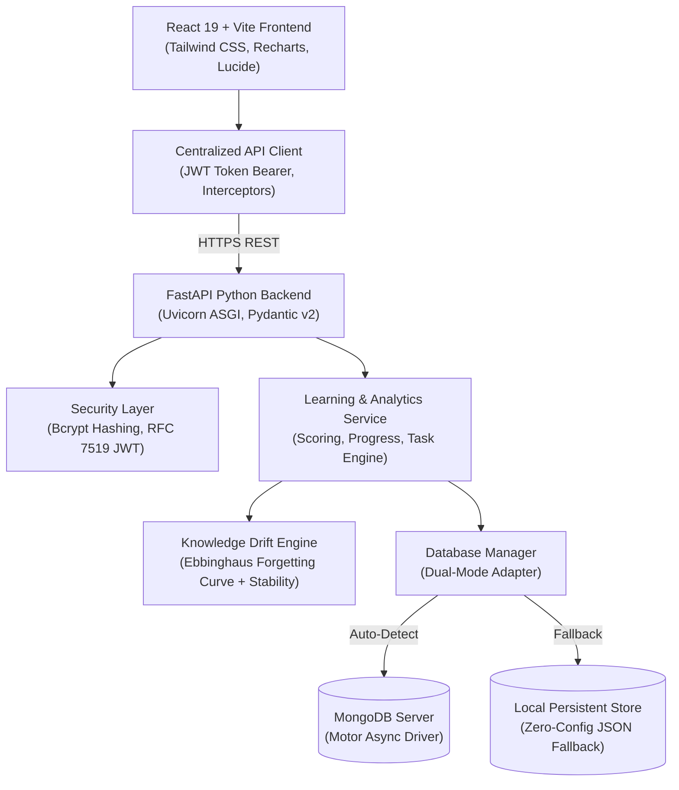

# keepLearning — AI-Powered Revision Plans: Knowledge Drift Prediction & Personalized Learning System

> **Final Year Project — Bachelor of Engineering / Technology in Computer Science & Engineering**  
> **Student:** Mugunthan M  
> **Domain:** Artificial Intelligence / Machine Learning in Education (EdTech), Adaptive Spaced Repetition, Full-Stack Web Architecture  

---

## 1. Project Abstract & Objectives

In modern technical education, students experience significant **knowledge decay** (the forgetting curve) after acquiring new programming and computer science concepts. Without active spaced recall, retention drops drastically within 7 to 14 days, leading to low retention and exam anxiety.

**keepLearning** is an end-to-end intelligent learning platform that dynamically forecasts knowledge drift at the topic level and generates personalized, timely revision tasks. Rather than presenting arbitrary static schedules, keepLearning applies an adaptive mathematical retention engine modeled on Hermann Ebbinghaus's exponential forgetting curve combined with learner practice history, quiz response accuracies, elapsed time intervals, and memory stability factors.

### Key Objectives:
1. **Accurate Knowledge Drift Forecasting**: Predict which technical topics a student is at risk of forgetting within a 14-day horizon.
2. **Personalized Spaced Repetition**: Automatically recommend micro-revision sessions (15–25 minutes) and targeted practice questions when decay probability crosses critical thresholds.
3. **End-to-End Interactive Curriculum**: Provide structured technical lessons (Java, SQL, Data Structures, Spring Boot) coupled with assessments, instant scoring, question explanations, and concept mastery breakdown.
4. **Strict Multi-Tenant Data Isolation**: Guarantee that every student's learning progress, quiz attempts, and revision tasks are completely isolated and cryptographically secured using JWT tokens and bcrypt password hashing.

---

## 2. System Architecture



---

## 3. Mathematical Formulation of Knowledge Drift

The keepLearning prediction engine is based on the **Ebbinghaus Forgetting Curve** enhanced with empirical **Memory Stability Scaling**:

$$R(t) = R_0 \cdot e^{-\frac{\lambda \cdot t}{S}}$$

Where:
- **$R(t)$**: Predicted percentage retention of the topic at elapsed time $t$ (in days since last review).
- **$R_0$**: Initial knowledge score achieved immediately after study/assessment ($0 \le R_0 \le 100$).
- **$\lambda$**: Base memory decay coefficient ($\lambda = 0.18$).
- **$S$**: **Memory Stability Index**. Represents synaptic trace durability. Stability scales dynamically based on practice repetition count $n$ and assessment accuracy:
  $$S = \frac{\left(1 + 0.45 \cdot n\right) \cdot \left(0.5 + 0.5 \cdot \frac{\text{accuracy}}{100}\right)}{\text{difficulty}}$$

### Knowledge Drift Probability & Risk Categorization:
Drift probability evaluates the projected 7-day retention deficit against the 80% mastery target combined with historical accuracy and time penalty:

$$\text{Drift Probability} = \min\left(96, \max\left(10, \text{round}\left(0.50 \cdot \Delta_{\text{decay}} + 0.25 \cdot \Delta_{\text{knowledge}} + 0.20 \cdot \Delta_{\text{accuracy}} + 0.20 \cdot t_{\text{penalty}} + 18\right)\right)\right)$$

| Drift Probability / Knowledge Level | Risk Category | Suggested Action |
|---|---|---|
| $\text{Drift} \ge 75\%$ OR $\text{Knowledge} < 55\%$ | **Critical** | Immediate 25-min revision + 6 practice questions within 24h |
| $\text{Drift} \ge 60\%$ OR $\text{Knowledge} < 68\%$ | **High** | 20-min revision + 5 practice questions within 48h |
| $\text{Drift} \ge 40\%$ OR $\text{Knowledge} < 80\%$ | **Medium** | 15-min review + 4 practice questions scheduled for this week |
| $\text{Drift} < 40\%$ AND $\text{Knowledge} \ge 80\%$ | **Low (Stable)** | Knowledge stable; routine 10-min refresher |

---

## 4. Technology Stack

- **Frontend**:
  - React 19 (`react`, `react-dom`)
  - Vite 8 (fast Hot Module Replacement and production bundling)
  - Tailwind CSS 4 (utility-first styling system)
  - Lucide React (vector iconography)
  - Recharts (knowledge trend and forecast visualization)
  - React Router DOM v7 (declarative client-side routing)
- **Backend**:
  - Python 3.10+ (tested on Python 3.14.6)
  - FastAPI (high-performance asynchronous REST API)
  - Pydantic v2 (strict request validation and serialization)
  - Uvicorn (ASGI web server)
  - Bcrypt (salt-hashed password cryptography)
  - PyJWT (RFC 7519 JSON Web Token issuance and verification)
  - Motor & PyMongo (asynchronous MongoDB database driver)
  - NumPy (numerical array handling)
  - Pytest & HTTPX (automated unit and integration test suite)
- **Database**:
  - **MongoDB** (collections: `users`, `subjects`, `topics`, `quizzes`, `quiz_attempts`, `user_topic_progress`, `revision_tasks`, `activities`).
  - **Zero-Config Persistent Engine**: If a standalone MongoDB daemon is not running on the evaluator's machine, the backend automatically activates a local JSON document persistence engine at `backend/data/`, ensuring the project runs immediately with zero external setup friction!

---

## 5. Prerequisites & Quick Start

### Prerequisites:
- **Node.js**: v18.0.0 or later (`node -v`)
- **Python**: v3.10 or later (`python --version`)
- *(Optional)* **MongoDB**: Running on `mongodb://localhost:27017` (auto-detected if present).

### Option A: One-Click Runner (Recommended)
On Windows, simply double-click or run:
```cmd
run_project.bat
```
or via PowerShell:
```powershell
.\run_project.ps1
```
This automatically verifies dependencies and launches both the FastAPI backend and Vite frontend in dedicated terminal windows!

---

### Option B: Manual Execution

#### 1. Start Backend:
```bash
cd backend
python -m venv venv
# On Windows:
venv\Scripts\activate
# On Linux/macOS:
source venv/bin/activate

pip install -r requirements.txt
python -m uvicorn app.main:app --host 127.0.0.1 --port 8000 --reload
```
*Backend API will be running at `http://localhost:8000` (Swagger interactive docs: `http://localhost:8000/docs`).*

#### 2. Start Frontend:
Open a second terminal:
```bash
cd KeepLearning
npm install
npm run dev
```
*Frontend application will be running at `http://localhost:5173`.*

---

## 6. Automated Testing & Verification

The repository includes a comprehensive automated test suite testing authentication, data isolation, learning workflows, and mathematical predictions.

### Run Automated Backend Tests:
```bash
cd backend
venv\Scripts\pytest.exe -v
```
**Results:** `7 passed in ~2.5s` (100% test pass rate).

### Run Live Full-Stack Network Verification:
With backend and frontend running:
```bash
cd backend
venv\Scripts\python.exe verify_live_system.py
```
This script executes real HTTP network requests testing registration, onboarding, quiz scoring, revision completion, and cross-user data isolation.

### Validate Frontend Production Build:
```bash
cd KeepLearning
npm run build
npm run lint
```
**Result:** Clean build completed in <1s with 0 errors.

---

## 7. Faculty Demonstration Walkthrough

For an academic project demonstration:

1. **Landing Page**: Navigate to `http://localhost:5173`. Highlight the value proposition, predictive retention engine, and feature breakdown.
2. **Registration & Onboarding**:
   - Register a new student account: `devika@keeplearning.io` / `Password123!`.
   - Walk through the 4-step onboarding wizard (Curriculum selection, Experience level, Daily commitment, Primary goal).
3. **Personalized Dashboard**:
   - Note the greeting (`Good morning, Devika 👋`), overall knowledge score, topics at risk, and **Today's Priority AI Recommendation Banner**.
4. **Learning Session**:
   - Click *My Learning* -> *Data Structures* -> *HashMap Internal Mechanics*.
   - Review the structured key concepts outline, lesson content, and code implementation snippet.
5. **Interactive Practice Assessment**:
   - Click *Take Practice Quiz Now*. Answer questions on bucket indexing, collision resolution, and rehashing.
   - Submit assessment to view the **instant score**, **knowledge recovery diff (+22%)**, **concept-level breakdown**, and **AI retention insight**.
6. **Spaced Repetition & Revision Plan**:
   - Click *Add to Revision Plan*.
   - View *Revision Plan* menu. Click the checkmark to mark a task completed. Note the real-time knowledge reinforcement (+14%) and activity logging.
7. **Verification of Cross-User Data Isolation**:
   - Sign out using the button at the bottom of the sidebar.
   - Register a second user: `mugunthan@keeplearning.io`.
   - Complete onboarding.
   - Demonstrate that Mugunthan starts with a completely clean state: 0 past quiz attempts, his own independent statistics, and zero cross-pollution from Devika's session.

---

## 8. API Endpoint Reference

| Method | Endpoint | Description | Auth Required |
|---|---|---|---|
| `POST` | `/api/auth/register` | Create account with password hashing | No |
| `POST` | `/api/auth/login` | Authenticate and issue JWT access token | No |
| `GET` | `/api/auth/me` | Fetch authenticated user profile | Bearer Token |
| `GET` | `/api/subjects` | List subjects with user mastery metrics | Bearer Token |
| `GET` | `/api/subjects/{id}` | Subject details and associated topics | Bearer Token |
| `GET` | `/api/topics` | All topics with personalized retention predictions | Bearer Token |
| `GET` | `/api/topics/{id}` | Single topic details and lesson content | Bearer Token |
| `GET` | `/api/topics/{id}/forecast` | 14-day retention decay curve | Bearer Token |
| `GET` | `/api/quizzes/{topicId}` | Quiz questions with masked answers | Bearer Token |
| `POST` | `/api/quizzes/{topicId}/submit` | Score quiz, update progress, log activity | Bearer Token |
| `GET` | `/api/quizzes/history/me` | User's personal quiz attempt history | Bearer Token |
| `GET` | `/api/revision-plan` | User's personalized revision task list | Bearer Token |
| `POST` | `/api/revision-plan/add` | Add topic to revision plan | Bearer Token |
| `POST` | `/api/revision-plan/{id}/complete` | Mark task completed & boost retention | Bearer Token |
| `POST` | `/api/revision-plan/{id}/reschedule` | Reschedule revision task category | Bearer Token |
| `GET` | `/api/dashboard` | Aggregated dashboard data for current user | Bearer Token |
| `GET` | `/api/analytics` | Telemetry progression & risk distribution | Bearer Token |
| `GET` | `/api/profile` | View profile and learning preferences | Bearer Token |
| `PUT` | `/api/profile` | Update profile information | Bearer Token |
| `POST` | `/api/profile/onboarding` | Submit onboarding choices | Bearer Token |
| `GET` | `/api/health` | Backend status & active database engine mode | No |

---

## 9. Security & Data Integrity

- **Password Hashing**: Implemented using `bcrypt` with unique cryptographic salts (`bcrypt.gensalt(12)`). Plaintext passwords are never saved.
- **RFC 7519 JWT Authentication**: Stateless bearer token verification with expiration (`HS256`).
- **Server-Side Authorization**: Every endpoint reading or mutating private records (quiz attempts, user progress, revision tasks) enforces `user_id` ownership on the server. Client-supplied IDs are never trusted blindly.
- **Input Sanitization**: Pydantic schemas enforce type validation, string length limits, and email format verification.
- **Zero Secret Leaks**: All credentials and signing keys are managed via environment variables with safe `.env.example` templates.
